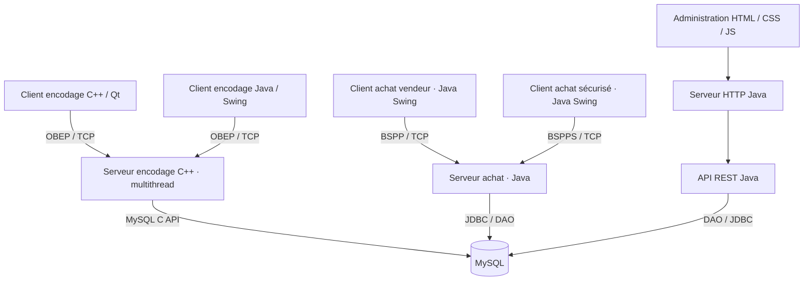

<div align="center">

# 📚 RTI — Online Bookstore

### Une librairie connectée, du poste vendeur à l'administration web

**Application client–serveur multi-langages · Programmation réseau · Base de données · Sécurité**

     

**Projet académique · Réseaux et technologies Internet · 2024–2025**

</div>

---

## Présentation

**RTI** est un projet de gestion et de vente de livres reposant sur plusieurs applications interconnectées. Il met en pratique les **sockets TCP/IP**, la communication entre **C/C++ et Java**, les **serveurs concurrents**, l'accès à **MySQL**, une **API REST** et des échanges sécurisés.

Le système est conçu pour trois utilisations :

- **Employés** : encoder les livres, les auteurs et les catégories du catalogue.
- **Vendeurs et clients** : rechercher des ouvrages et gérer des paniers d'achat via des applications desktop.
- **Responsables** : consulter et administrer les données à partir d'une interface web.

> Ce dépôt présente un projet pédagogique, et non une plateforme e-commerce prête à être déployée en production. Les modules et fonctionnalités ci-dessous sont décrits à partir des fichiers présents dans le dépôt ; leur bon fonctionnement de bout en bout dépend de la configuration des différents serveurs et de la base de données.

## Aperçu de l'interface web

<div align="center">


*Visuel d'accueil présent dans le frontend du projet (et non capture d'une session de démonstration).*

</div>

L'interface web comporte des pages dédiées aux **livres**, **auteurs** et **sujets**, avec des fichiers HTML, CSS et JavaScript distincts. Le dépôt inclut également une variante graphique `welcome-dark.png`.

## Technologies

| Couche | Technologies | Rôle |
|---|---|---|
| Réseau et serveur d'encodage | C/C++, sockets TCP, POSIX threads | Échanges clients–serveur et traitement concurrent |
| Client desktop d'encodage | Qt / C++ et Java Swing | Gestion du catalogue |
| Achat en magasin | Java, Swing, `java.net` | Recherche de livres et gestion du panier |
| Achat sécurisé | Java, Bouncy Castle | Échanges utilisant des mécanismes cryptographiques |
| Persistance | MySQL, JDBC, DAO | Gestion des entités et des transactions métier |
| API d'administration | Java, HTTP, JSON | Accès REST aux livres, auteurs et sujets |
| Interface d'administration | HTML, CSS, JavaScript | Consultation et opérations d'administration |
| Construction | Maven, CMake | Build des modules Java et C++ |

## Architecture



*Vue logique simplifiée : la communication entre la page web et l'API dépend des scripts et de la configuration exécutée.*

### Protocoles réseau

| Protocole | Usage | Implémentation |
|---|---|---|
| **OBEP** | Online Books Encoding Protocol : authentification et encodage du catalogue | Client C++ / Qt, client Java et serveur C++ |
| **BSPP** | Books Shopping Payment Protocol : opérations de recherche et de panier | Clients et serveur Java |
| **BSPPS** | Variante sécurisée du protocole d'achat | Client/serveur Java et fonctions cryptographiques |
| **HTTP / REST** | Gestion distante du catalogue | Serveur HTTP, API Java et frontend JS |

## Fonctionnalités couvertes par le code

### 1. Encodage du catalogue

- Interfaces d'encodage Qt et Java Swing.
- Fenêtres d'authentification et de création d'auteurs/sujets.
- Échanges via un protocole d'encodage commun entre clients et serveur.
- Modèles de livres, auteurs, sujets et employés.
- Serveur d'encodage C++ utilisant des composants réseau et de gestion de threads.

### 2. Achats et paniers

- Interfaces Swing pour vendeur et client.
- Recherche de livres, affichage tabulaire et gestion du panier.
- Requêtes et réponses dédiées à l'ajout, à la suppression et à la validation d'un panier.
- Serveur Java avec implémentations de protocoles `ProtocolBSPP` et `ProtocolBSPPS`.

### 3. Persistance et accès aux données

- Classes métier : `Book`, `Author`, `Subject`, `Client`, `Employee`, `Caddy`, `CaddyItem`.
- DAO dédiés aux différentes entités.
- Classes `SearchVM` pour les critères de recherche.
- Connexion JDBC à une base MySQL et utilitaire C++ de création de base.

### 4. Administration web

- Pages `index.html`, `books.html`, `authors.html` et `subjects.html`.
- Scripts JavaScript pour les interactions avec l'API.
- API Java exposant les routes `/api/books`, `/api/authors` et `/api/subjects`.
- Feuilles de style modulaires et prise en charge d'un thème visuel.

### 5. Cryptographie et sécurité

- Variante sécurisée du client et du serveur d'achat.
- Utilitaires `CryptoHelper` et `CertificateHelper`.
- Dépendance à **Bouncy Castle** et présence de fichiers de magasins de clés (`.jks`).

**Important :** les mécanismes cryptographiques font partie d'un exercice de programmation réseau ; ils ne constituent pas à eux seuls une garantie de sécurité pour un usage commercial réel.

## Organisation du dépôt

```text
RTI/
├── config.properties           # Ports et adresses des services
├── java/
│   ├── api-rest/               # Routes REST pour le catalogue
│   ├── serveur-http/           # Serveur et interface d'administration
│   ├── serveur-achat/          # Serveur d'achat BSPP / BSPPS
│   ├── client-encoder-java/    # Client d'encodage Swing
│   ├── client-achat-java/      # Client d'achat Swing
│   ├── client-achat-java-S/    # Client d'achat sécurisé
│   ├── my-libraries/
│   │   ├── dao/                # Entités, DAO et recherche
│   │   ├── file/               # Utilitaires fichiers/configuration
│   │   └── my-request/         # Requêtes, réponses et cryptographie
│   ├── settingsDB.properties   # Configuration de la base de données
│   └── pom.xml                 # Build Maven multi-modules
├── moon-VMware/
│   ├── BD_Books/               # Initialisation de la base
│   ├── ClientBookEncoderQt/    # Interface C++ / Qt
│   ├── Encodage_S/             # Serveur d'encodage C++
│   ├── MyLibraries/            # Socket, protocole, BD, fichiers
│   └── CMakeLists.txt          # Build CMake
└── pom.xml
```

## Installation et compilation

### Prérequis

- **JDK 23** (version déclarée dans le `pom.xml` du projet Java).
- **Maven**.
- **MySQL** et connecteur JDBC nécessaire aux modules Java.
- Sur Linux, pour la partie C++ : **CMake ≥ 3.10**, compilateur compatible **C++11**, **Qt 5 Widgets**, bibliothèque cliente de **MySQL** et **pthread**.
- Accès réseau entre les différents services.

### Compiler les modules Java

Depuis la racine `RTI/` :

```bash
mvn clean package
```

Le projet contient un `pom.xml` racine et une arborescence Maven multi-modules sous `java/`. Si le build global échoue, vérifiez d'abord les versions du JDK, les dépendances locales et la configuration Maven des différents modules.

### Compiler les modules C++

```bash
cd moon-VMware
cmake -S . -B build
cmake --build build
```

Le `CMakeLists.txt` définit deux cibles : **`ServerApp`** (serveur d'encodage) et **`ClientApp`** (client Qt). Certains chemins MySQL y sont propres à l'environnement Linux d'origine et peuvent devoir être adaptés.

### Configurer les services

Le fichier `config.properties` à la racine contient notamment :

| Paramètre | Usage |
|---|---|
| `NUM_THREADS` | Nombre de threads configuré |
| `IP_ENCODING`, `PORT_ENCODING` | Adresse du serveur d'encodage |
| `IP_PURCHASE`, `PORT_PURCHASE` | Serveur d'achat standard |
| `IP_PURCHASE_SECURE`, `PORT_PURCHASE_SECURE` | Serveur d'achat sécurisé |
| `PORT_ADMIN_API` | Port de l'API REST |
| `PORT_ADMIN_HTTP` | Port de l'interface HTTP |

**Exemple de configuration locale** (à adapter à vos machines) :

```properties
NUM_THREADS=2
IP_ENCODING=127.0.0.1
PORT_ENCODING=50000
IP_PURCHASE=127.0.0.1
PORT_PURCHASE=50002
IP_PURCHASE_SECURE=127.0.0.1
PORT_PURCHASE_SECURE=50001
PORT_ADMIN_API=8080
PORT_ADMIN_HTTP=8085
```

> Le port d'achat de cet exemple a été distingué de celui de l'encodage pour éviter un conflit lors d'une exécution sur la même machine. Il faut synchroniser ces valeurs dans les fichiers des clients et serveurs concernés.

Pour MySQL, renseignez une base locale et un utilisateur dédié dans la configuration JDBC `java/settingsDB.properties`. **Ne publiez pas de vrais mots de passe dans GitHub.**

### Ordre de démarrage recommandé

1. Créer et démarrer la base MySQL, puis initialiser son schéma (utilitaire présent dans `moon-VMware/BD_Books/`).
2. Vérifier la connexion à MySQL et les propriétés JDBC.
3. Démarrer le serveur d'encodage, puis le client Qt ou Java.
4. Démarrer le serveur d'achat Java, puis un client d'achat.
5. Démarrer l'API REST Java et ensuite le serveur HTTP d'administration.
6. Ouvrir l'interface web via l'adresse et le port configurés (par exemple `http://localhost:8085`).

**Note de reproductibilité :** cet ordre correspond aux dépendances entre composants. Les commandes exactes de lancement de chaque classe Java dépendent du classpath généré par Maven et des dépendances installées ; le fonctionnement complet n'a pas été validé ici par un test d'intégration.

## API REST

Le module `java/api-rest` déclare les points d'entrée suivants :

```text
/api/books
/api/authors
/api/subjects
```

Les handlers s'appuient sur les DAO et les modèles de recherche correspondants. Le détail des méthodes HTTP, des corps JSON et des réponses se trouve dans `java/api-rest/src/main/java/be/hepl/handler.java` ainsi que dans les scripts sous `java/serveur-http/src/main/java/be/hepl/view/js/http/`.

## Compétences mises en pratique

- **Conception d'une architecture répartie** et échanges entre services.
- **Programmation TCP/IP** et définition de protocoles applicatifs.
- **Multithreading et concurrence** en C++ et Java.
- **Interopérabilité** entre clients développés dans des langages différents.
- **JDBC, modèle DAO** et séparation des responsabilités.
- **Interfaces graphiques desktop** et **frontend web**.
- **Sécurisation de messages** et manipulation de mécanismes cryptographiques.
- **Organisation de projets multi-modules** avec Maven et CMake.

## Limites et améliorations possibles

Ce projet constitue une base technique pédagogique. Pour en faire une application maintenable et déployable, plusieurs étapes seraient utiles :

- Automatiser les tests d'intégration entre les clients, les serveurs et MySQL.
- Fournir des scripts de démarrage unifiés ou des conteneurs Docker.
- Extraire tous les secrets et paramètres propres aux machines dans des variables d'environnement.
- Ajouter une documentation détaillée de l'API (OpenAPI, exemples de requêtes/réponses).
- Renforcer l'authentification, la gestion des erreurs et les contrôles de sécurité.
- Ajouter des captures d'écran des applications **réellement exécutées**.

## Contexte

Projet réalisé dans le cadre du laboratoire de **Réseaux et technologies Internet (2024–2025)**, consacré à la construction d'une librairie en ligne et au développement de services interopérables en C/C++, Java et technologies web.

Les documents de cours fournis avec le projet décrivent le cahier des charges fonctionnel et les concepts de construction avec CMake. Ce README présente **l'organisation et les composants du dépôt fourni**, sans supposer que toutes les fonctionnalités prévues dans le cahier des charges ont été validées en exécution.

---

<div align="center">

**RTI — Un projet pour comprendre comment les applications communiquent, partagent des données et gèrent des opérations métier.**

</div>
